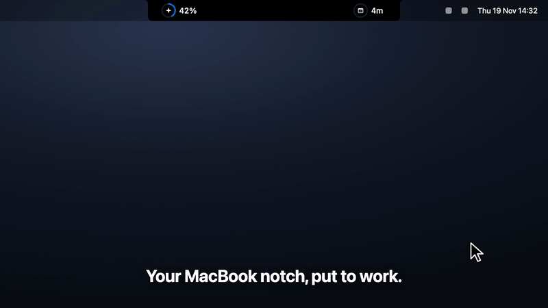

# Brim

A free notch app for macOS. Brim turns the MacBook notch into a live strip for your next call, your music, a timer, a file shelf and your Claude Code sessions. On screens without a notch, it floats as a small pill at the top.

**This repository holds releases, the changelog and the issue tracker. Brim's source code is not public.**

Website: https://brim-ehw.pages.dev/?ref=github · Changelog: https://brim-ehw.pages.dev/changelog



## What it does

- **Next meeting:** countdown, a Join button five minutes before, and a camera mirror.
- **File shelf:** drop files on the notch; convert HEIC to JPEG, resize, remove a background, convert video to MP4, AirDrop.
- **Now Playing:** Music, Spotify and the browser.
- **Timer, screen recorder, keep awake, keyboard lock, mic mute.**
- **Works with Claude Code:** each session's status (waiting, working, done), your 5-hour and weekly limits from Claude Code's status line, and optional Allow/Deny of tool requests from the notch (off by default).
- **`brim` CLI:** `brim run -- <cmd>` tells you when a long command finishes; `brim notify` for your own scripts.
- **Pip**, a small dog that lives in the notch.

## Requirements

- macOS 15 Sequoia or later
- Apple Silicon (M1 or newer)
- Claude Code is optional; only the Claude features need it.

## Install

One command (recommended):

```sh
curl -fsSL https://brim-ehw.pages.dev/install.sh | BRIM_REF=github sh
```

Or with Homebrew:

```sh
brew install --cask getbrim/tap/brim
```

Read the install script first if you like: https://brim-ehw.pages.dev/install.sh. It downloads the zip, checks its SHA-256 against `latest.json`, verifies the code signature, copies Brim to /Applications and optionally links `brim` into `~/.local/bin`. It doesn't use sudo unless /Applications isn't writable, and then it asks.

Or download the DMG or zip from the [Releases](../../releases) page.

Brim updates itself from inside the app.

### "Apple could not verify Brim"

Brim is free, so it isn't notarized by Apple (that needs a paid developer account). It is signed with Brim's own certificate. The one-command install doesn't trigger this dialog. With the DMG, once:

1. Open Brim, then click **Done**.
2. System Settings → Privacy & Security → "Brim" was blocked → **Open Anyway**.
3. Authenticate and click **Open Anyway** again.

## Verify a download

Each release lists the SHA-256 of its files. The current values are also in https://brim-ehw.pages.dev/latest.json.

```sh
shasum -a 256 Brim-1.0.9.zip
curl -fsSL https://brim-ehw.pages.dev/latest.json     # compare with "zip" → "sha256"
ditto -x -k Brim-1.0.9.zip out && codesign --verify --deep --strict --verbose=2 out/Brim.app
```

## What Brim changes on your Mac

- `/Applications/Brim.app`
- Optional: a `brim` symlink in `~/.local/bin`
- Launch at login (a login item; toggle it in Settings)
- Its preferences (`dev.daniel.brim`) and a local socket in `~/Library/Application Support/Brim/`
- Only if you connect Claude Code: Brim's hooks and a `statusLine` command in `~/.claude/settings.json` (or `$CLAUDE_CONFIG_DIR/settings.json`). Your existing status line is chained, not replaced. The file is backed up before every write as `settings.json.brim-backup-<unix time>`.

Brim asks for macOS permissions (Calendars, Camera, Microphone, Screen Recording, Accessibility, Bluetooth, Automation) only when you turn on the feature that needs them.

## Privacy

- No account, no sign-in, no ads.
- Calendar events, files, recordings and settings stay on your Mac.
- **Claude usage comes only from Claude Code's status line.** Brim never reads the Keychain or your Claude login and makes no requests to Anthropic.
- **One anonymous ping a day:** a random install id made on your Mac, the Brim and macOS versions, which Brim modules are switched on, and the channel you installed from if your install link named one (e.g. `reddit`). Nothing else. It is always on, and the same request checks for updates. IP addresses are not stored; pings are deleted after 90 days. Public totals: https://brim-ehw.pages.dev/stats.html
- Feedback is sent only if you write it and press Send.

## Uninstall

Brim's menu-bar icon → **Uninstall Brim…**. It shows what it will remove, then removes Brim's Claude Code hooks and restores your previous status line, removes the `brim` symlink (only if it points at this Brim), the login item and its settings, and moves Brim to the Trash.

From a terminal, the Claude Code part alone:

```sh
/Applications/Brim.app/Contents/Helpers/brim hooks uninstall claude-code
/Applications/Brim.app/Contents/Helpers/brim statusline uninstall
```

## Report a bug or ask for a feature

[Open an issue](../../issues/new). Please include:

- Brim version and macOS version
- Mac model, and whether it's the notch or an external display
- What you did, what you expected, what happened
- Logs if relevant: `log show --last 10m --predicate 'subsystem == "dev.daniel.brim"'` (check them for anything personal before pasting)

Security issues: please don't open a public issue. Use **Security → Report a vulnerability** on this repository, which is private between you and the maintainer.

## License

Brim is free to use. It is closed-source, proprietary software; this repository contains no source code.

Brim is not affiliated with or endorsed by Apple or Anthropic. Claude Code is a product of Anthropic.
